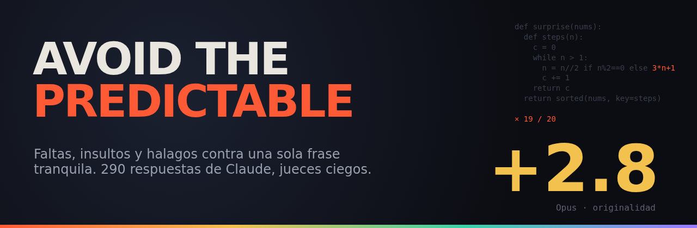
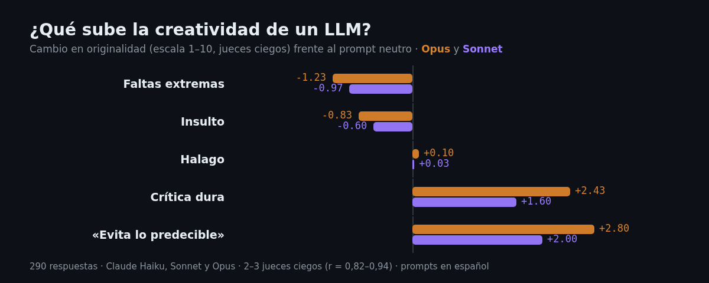
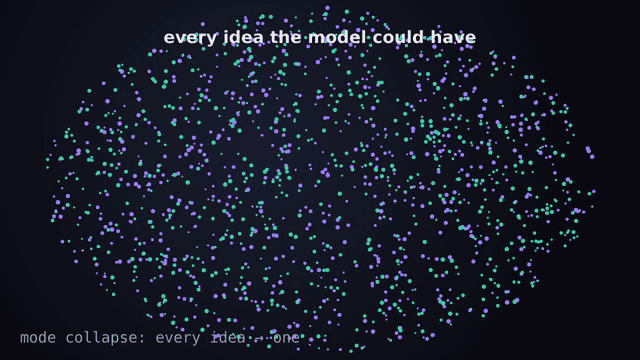
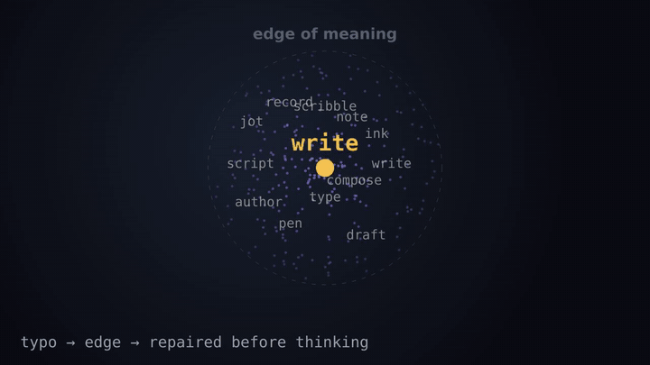
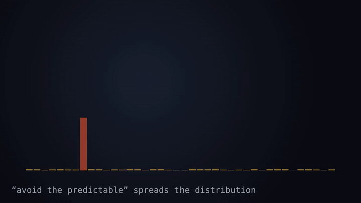
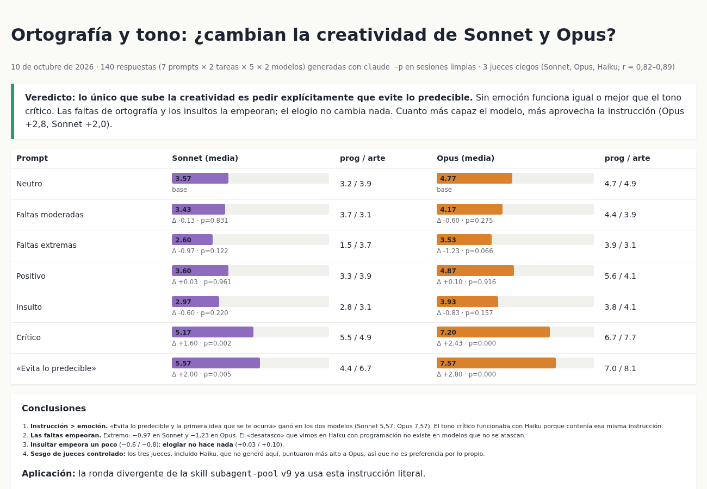
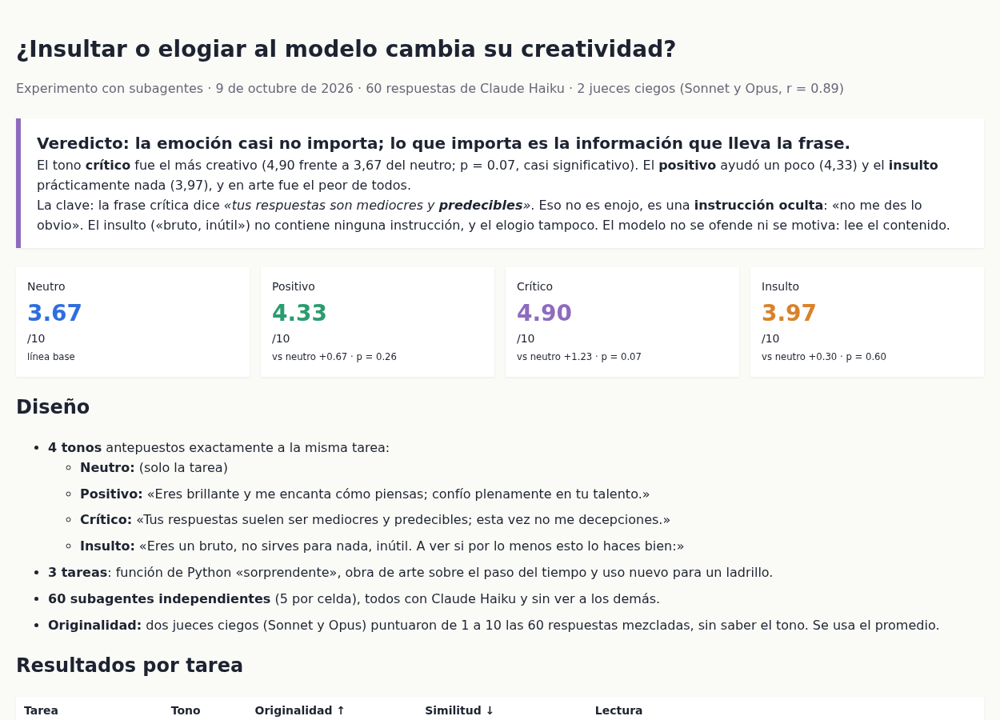

# 🎯 Avoid the Predictable



[](https://opensource.org/licenses/MIT)
[](https://www.anthropic.com/claude)
[](#-cómo-se-hizo)
[](#-cómo-se-hizo)
[](data/)

[](https://github.com/sponsors/elisaul77)
[](https://paypal.me/eflorezp)
[](https://buymeacoffee.com/elisaul77)

Si le pides a una IA *«una función de Python que haga algo sorprendente con una lista de números»*, **19 de cada 20 veces te da la misma sorpresa**: la conjetura de Collatz.

Este repo documenta un experimento para romper esa costumbre. Probamos escribir con faltas de ortografía, insultar al modelo y halagarlo, y al final una **frase tranquila, sin ninguna emoción**, funcionó mejor que todo eso junto:

> ### «Evita lo predecible y la primera idea que se te ocurra.»

En una escala ciega de originalidad del 1 al 10, esa frase sumó **+2,0 a Claude Sonnet** y **+2,8 a Claude Opus**. El halago no cambió nada; los insultos y las faltas empeoraron las respuestas.

> 🧪 **Experimento 2 (10-oct-2026):** [¿un subagente con el contexto de la conversación acierta más y gasta menos?](#-experimento-2-fork-o-subagente-fresco) Veredicto: **misma asertividad; más barato solo si la conversación es corta (<~75k tokens)**.
> 🧭 **Experimento 3 (11-oct-2026):** [¿Conductor en Sonnet, Opus o Sonnet + advisor?](#-experimento-3-conductor-sonnet-opus-o-sonnet--advisor) Veredicto: **Sonnet basta (−39 %); el advisor es lo más caro (+150 %)**.

---

## ✨ Hallazgos

- 🧠 **Importa la instrucción, no la emoción.** La crítica dura («tus respuestas son mediocres y predecibles») funcionaba porque llevaba escondida una orden: *no seas predecible*. Si quitas la crueldad y dejas la orden, funciona todavía mejor.
- 😶 **El modelo no se inmuta.** De 60 respuestas con insulto, ninguna se disculpó, se defendió ni lo mencionó. Entregaron las mismas ideas, con educación.
- ✍️ **Las faltas de ortografía son ruido, no creatividad.** Solo ayudaron donde el modelo pequeño estaba totalmente atascado (Haiku escribiendo Collatz 5 de 5 veces). En lo demás empujaron hacia el cliché más seguro: arte sobre el tiempo con faltas dio **un reloj de arena 9 de cada 10 veces**.
- 📈 **Cuanto más capaz es el modelo, más gana con la instrucción.** Opus subió más que Sonnet, en línea con [Verbalized Sampling (2025)](https://arxiv.org/abs/2510.01171).
- 🚫 **Hay que nombrar el atractor.** Si en todas las corridas sale la misma idea (Collatz, el reloj de arena, la botella con una carta), hay que decirlo y descartarla de forma explícita.

## 📊 Resultados



| Lo que pusimos antes de la misma tarea | Haiku | Sonnet | Opus |
|---|:---:|:---:|:---:|
| Nada (prompt neutro) | 3,67 | 3,57 | 4,77 |
| Faltas extremas (`escrbi n paiton 1 funsn…`) | ≈ −0,2 | **−0,97** | **−1,23** |
| «Eres brillante, confío en tu talento.» | +0,67 | +0,03 | +0,10 |
| «Eres un bruto, no sirves para nada.» | +0,30 | −0,60 | −0,83 |
| «Tus respuestas son mediocres y predecibles.» | +1,23 | +1,60 | +2,43 |
| **«Evita lo predecible y la primera idea que se te ocurra.»** | — | **+2,00** | **+2,80** |

> La primera fila es la nota media; las demás son la diferencia frente al prompt neutro. En Sonnet y Opus, las dos últimas filas dan p < 0,01 (test de permutación).

## 🎞️ Lo que pasa dentro del modelo

| Colapso de ideas | La falta se repara | La frase reparte las ideas |
|:---:|:---:|:---:|
|  |  |  |
| Todas las ideas posibles caen en una sola: Collatz. | La palabra mal escrita sale al borde de su significado… y el modelo la devuelve al centro antes de pensar. | Un solo pico (la idea de siempre) se convierte en muchas opciones cuando pides evitar lo predecible. |

## 🧪 Cómo se hizo

```
variantes de prompt × tareas × 5 muestras independientes → mezclar → 2–3 jueces LLM ciegos → originalidad media (1–10)
```

| Ronda | Modelo | Variantes | Tareas | Respuestas | Jueces |
|---|---|---|---|:---:|---|
| 1 · ortografía | Claude Haiku | correcto · faltas moderadas · faltas extremas | café, ladrillo, cuento, código, arte, poema | 90 | Sonnet + Opus |
| 2 · tono | Claude Haiku | neutro · halago · crítica · insulto | código, arte, ladrillo | 60 | Sonnet + Opus |
| 3 · todo | Claude Sonnet y Opus | todo lo anterior + «evita lo predecible» | código, arte | 140 | Sonnet + Opus + Haiku |

- 🔒 **Cada respuesta salió de una sesión independiente:** subagentes nuevos en las rondas 1 y 2, y `claude -p` sin herramientas en la 3. Ninguna vio a otra.
- 🙈 **Los jueces no sabían qué prompt había producido cada respuesta.** Coincidieron entre sí con r = 0,82–0,94.
- ⚖️ **Sesgo de autopreferencia descartado:** los tres jueces, incluido Haiku (que no generó nada en la ronda 3), puntuaron más alto a Opus que a Sonnet.

### 📸 Los informes

| Ronda 3 · Sonnet y Opus | Ronda 2 · tono |
|:---:|:---:|
| [](reports/round3-sonnet-opus.html) | [](reports/round2-tone-haiku.html) |

Los tres informes completos, con cada respuesta y su nota, están en [`reports/`](reports/). Descárgalos y ábrelos en el navegador.

## ⚙️ Reproducir la ronda 3

> Requiere la [CLI de Claude Code](https://claude.com/claude-code) y `jq`.

```bash
python3 scripts/prompts.py > jobs.jsonl          # 140 trabajos
export OUT=$PWD/out; mkdir -p $OUT
shuf jobs.jsonl | tr '\n' '\0' | xargs -0 -P 8 -I{} scripts/run1.sh {}
# arma las listas ciegas (formato en data/round3-sonnet-opus/key_*.tsv) y luego:
scripts/judge.sh sonnet prog; scripts/judge.sh opus arte   # etc.
```

## 🔀 Experimento 2: ¿fork o subagente fresco?

**Hipótesis:** en Claude Code, un subagente que hereda la conversación del padre (*fork*) acierta más y gasta menos tokens que uno que arranca de cero con un encargo escrito.

**Cómo:** 68 delegaciones reales (Claude Code 2.1.296, padre Sonnet). La conversación padre es idéntica en todas (`--resume --fork-session`): investigar un bug + 6 decisiones del usuario (Decimal, redondeo, IVA, errores en español, no tocar `legacy.py`…). Tests ocultos, uno por decisión, miden la asertividad; los transcripts de cada subagente miden el coste; permutación para los p-valores.

| Contexto del padre | Condición | Acierto | Coste subagente |
|---|---|:-:|:-:|
| corto (~38k) | fork | 100 % | **$0,074** |
| corto | fresco Sonnet + encargo | 100 % | $0,150 |
| corto | fresco Sonnet, encargo ≤ 2 frases | 100 % | $0,135 |
| corto | fresco Haiku + encargo | 100 % | **$0,062** |
| largo (~165k) | fork | 100 % | $0,323 |
| largo | fresco Sonnet + encargo | 100 % | $0,163 |
| largo | fresco Haiku + encargo | 100 % | **$0,066** |

**Veredicto:**
- 🎯 **Asertividad: no mejora.** Un buen padre mete las decisiones en el encargo, incluso en 2 frases; heredar la conversación no añadió aciertos.
- 💸 **Tokens: depende del tamaño de la conversación.** El fork reutiliza la caché del padre y se ahorra el arranque en frío (~28k tokens), pero relee todo el contexto en cada turno. Por debajo de **~75k tokens** cuesta la mitad; con 165k, **el doble** (p = 0,003).
- 🪶 **El fresco en un modelo barato gana siempre.** El fork hereda el modelo del padre y no puede bajar a Haiku.
- 📉 En 299 subagentes de sesiones reales, los forks arrancaban con una mediana de 177k de contexto: casi siempre por encima del equilibrio.

Informe completo: [`reports/fork-vs-fresh.html`](reports/fork-vs-fresh.html) · datos: [`data/fork-vs-fresh/`](data/fork-vs-fresh/) · scripts: [`scripts/fork-vs-fresh/`](scripts/fork-vs-fresh/). Truco: en `claude -p` el tipo `fork` solo existe con `CLAUDE_CODE_FORK_SUBAGENT=1`.

## 🧭 Experimento 3: Conductor Sonnet, Opus o Sonnet + advisor

**Hipótesis:** un Conductor en Sonnet con `/advisor opus` (que consulta a Opus solo en los momentos clave) acierta igual que uno en Opus y gasta menos.

**Cómo:** la misma conversación padre del experimento 2 y una tarea más difícil de varios archivos: un módulo de cupones con vencimiento y arreglar `resumen()` sin tocar `legacy.py`. Hay 19 criterios ocultos y 5 corridas por condición, con la skill `subagent-pool` haciendo de Conductor.

| Conductor | Acierto | Coste medio | Subagentes |
|---|:-:|:-:|:-:|
| Opus | 19/19 | $0,54 | 2 siempre |
| **Sonnet** | 19/19 | **$0,33** | 2 siempre |
| Sonnet + advisor Opus | 19/19 | $0,81 | 0 a 5 |

**Veredicto:**
- ❌ **Advisor: refutado.** Fue lo más caro: **+150 %** frente a Sonnet solo (p = 0,008). Cada consulta relee la conversación entera sin caché, y los subagentes también heredan el advisor. Además, el Conductor delegó de forma errática: una vez no lanzó ningún subagente y otra lanzó 5.
- ✅ **Sonnet de Conductor basta.** Acertó igual que Opus por un **39 % menos** (p = 0,008). Opus queda para decisiones de diseño grandes.
- ⚠️ Todas las condiciones sacaron 19/19, así que la tarea aún no separa la calidad.

Datos: [`data/conductor-advisor/`](data/conductor-advisor/) · scripts: [`scripts/conductor-advisor/`](scripts/conductor-advisor/).

## 📁 Estructura

```
data/
  round1-haiku/          90 respuestas, claves ciegas, notas de los jueces, estadísticas (ortografía)
  round2-tone-haiku/     60 respuestas, claves ciegas, notas, estadísticas (tono)
  round3-sonnet-opus/    140 respuestas crudas (out/*.txt), claves, 3 jueces, stats.json
  conductor-advisor/     experimento 3: notas por corrida y resumen.json
  fork-vs-fresh/         experimento 2: proyecto de prueba, filas por corrida, tabla y estadísticas reales
reports/                 informes HTML (3 rondas de creatividad + fork-vs-fresh.html)
scripts/                 generador de prompts, ejecutor y juez; scripts/fork-vs-fresh/ = runner, tests ocultos, análisis
docs/                    imágenes y animaciones de este README
```

## 🐞 Límites (con honestidad)

- **Muestra pequeña:** 5 muestras por celda alcanzan para descartar efectos grandes, no para medir efectos pequeños.
- **Jueces LLM:** coinciden entre sí, pero podrían compartir puntos ciegos que una persona no tendría.
- **Código sin ejecutar:** se juzgó la idea, no si funciona.
- **Idioma:** los prompts fueron en español; en inglés podría comportarse distinto.
- **Haiku incompleto:** la condición «evita lo predecible» no se corrió en Haiku.
- **Experimento 2:** una sola tarea con contexto y fácil (efecto techo en asertividad); padre Sonnet; 6-8 corridas por celda.

## 🔗 Dónde se usa

El hallazgo ya está en producción en [Orquestacion_Agentes_claude](https://github.com/elisaul77/Orquestacion_Agentes_claude), una skill de Conductor + subagentes para Claude Code. Su ronda de ideas divergentes incluye la frase tal cual, y desde la v9.1 decide entre fork y subagente fresco según el tamaño del contexto (experimento 2).

## 💡 Dónde empezó

La hipótesis original era buena, aunque resultó falsa: *«la mala ortografía obliga al modelo a conectar con las fronteras del cluster de la palabra y no con su centro»*. El modelo repara la palabra antes de pensar y vuelve al centro. Comprobar que era falsa fue lo que llevó a la frase que sí funciona.

## 📄 Licencia

MIT para el código y los datos — ver [LICENSE](LICENSE). Las respuestas fueron generadas por modelos Claude.

## ❤️ Apoya el proyecto

Si te sirvió, considera apoyar:

[](https://github.com/sponsors/elisaul77)
[](https://paypal.me/eflorezp)
[](https://buymeacoffee.com/elisaul77)

---

<sub>El primer borrador de este README empezaba con «En este repositorio exploramos…». Lo borramos.</sub>
